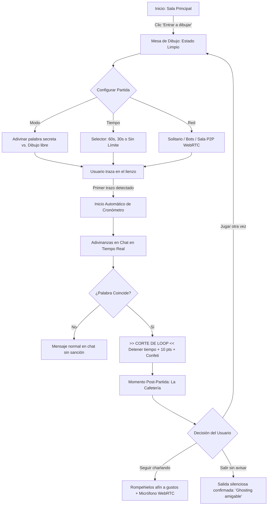
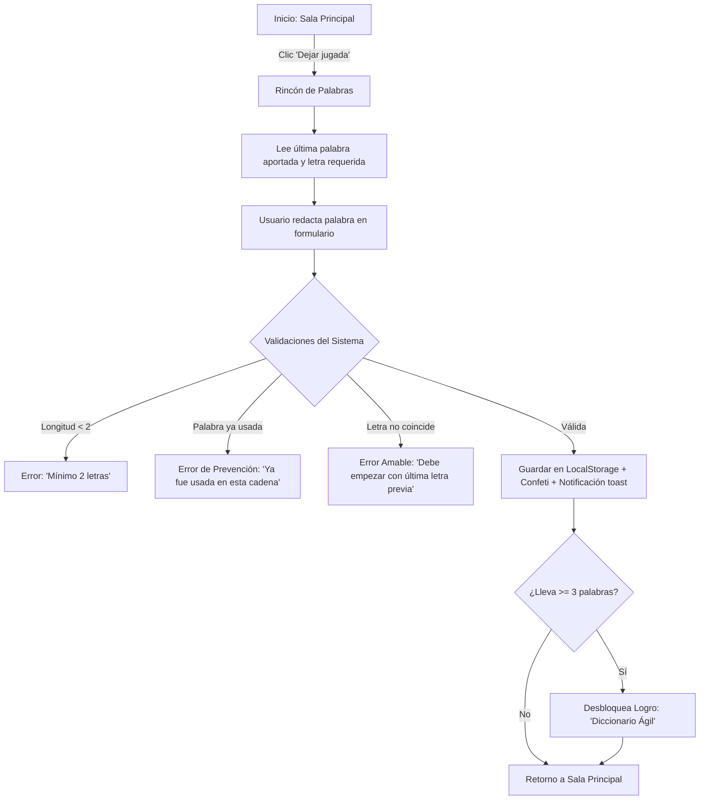
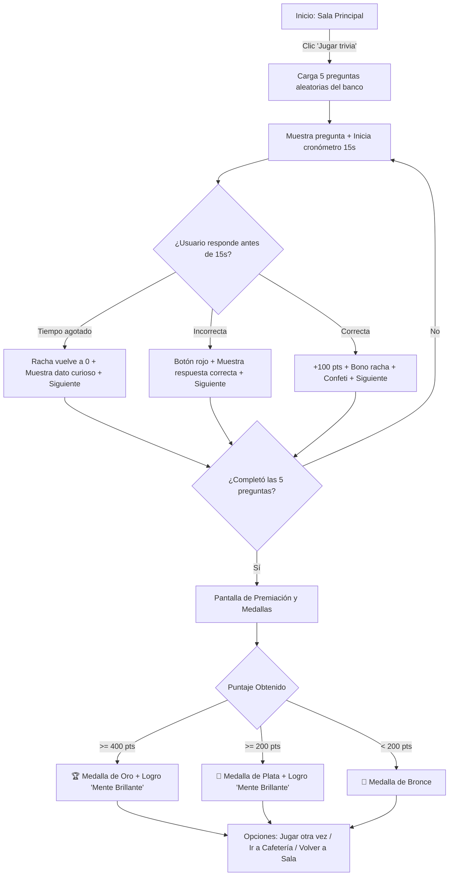
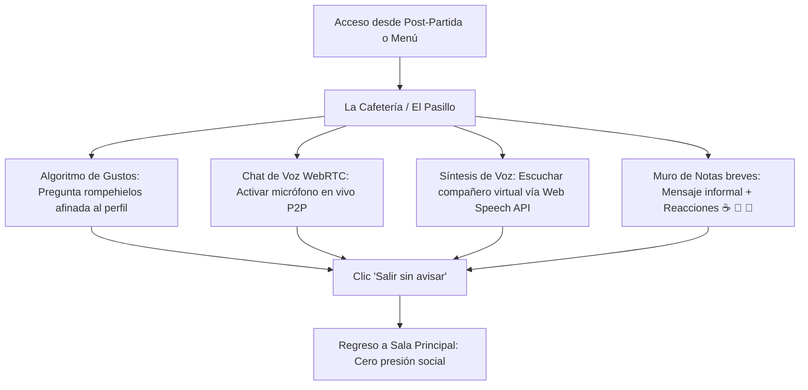

# Entregable 6: Evaluación del Prototipo PlayBreak, Diagramas de Flujo de Tareas y Plan de Implementación

**Universidad Nacional de Colombia — Facultad de Minas — Sede Medellín**  
**Departamento de Ciencias de la Computación y de la Decisión**  
**Interacción Humano-Computador (IHC)**  
**Grupo #7:**
- Edgar Fernando Vega Morales
- Hinara Pastora Sanchez Mata
- Jacobo Zapata Rojas
- Vincent David Restrepo Tangarife

**Semestre Académico 2025-1 / Febrero - Octubre 2026**  
**Medellín, Antioquia, Colombia**

---

## 1. Hoja Resumen Ejecutiva (*Executive Summary Sheet*)

| Aspecto | Resumen Ejecutivo de la Evaluación y Rediseño |
| :--- | :--- |
| **Propósito y Alcance** | Evaluar la usabilidad y adopción de PlayBreak como plataforma de micro-pausas activas no invasivas para mitigar la fatiga virtual y el aislamiento en equipos remotos. Se evaluaron 4 flujos principales con 5 participantes bajo protocolo *Think-Aloud*. |
| **Población y Muestra** | 5 participantes ($n = 5$) representativos de la persona arquetípica Juliana Ospina (profesionales de teletrabajo/híbrido). Prueba moderada con protocolo *Think-Aloud* y cuestionario estandarizado SUS. |
| **Métricas SUS Consolidadas** | • **Promedio SUS**: **77,5 / 100** (Grado B+ / Aceptable - Buena según Bangor et al., 2008) • **Mediana SUS**: **92,5 / 100** (Grado A+ / Rango de Excelencia) • **Sensación de Seguridad (Ítem 9)**: **4,8 / 5,0** (Máxima puntuación: valida cero presión social) • **Fricción Inicial (Ítem 4)**: **2,2 / 5,0** (Punto débil corregido: desconcierto en onboarding) |
| **Gráfico Semáforo Consolidado** | 🟢 **Verde (Excelente)**: Mesa de Dibujo, Momento Post-Partida, Salida Silenciosa, Ausencia de Presión. 🟡 **Amarillo (Fricción Menor)**: Petición de temporizador, modos de juego y variedad lúdica. 🔴 **Rojo (Crítico en v1)**: Jugadores hardcodeados en código que confundieron al P2 (SUS: 32,5). |
| **Top 3 Hallazgos Críticos** | 1. **Onboarding confuso por bots ficticios fijos** (*Severidad 3: Mayor* -> Resuelto con partida limpia de cero). 2. **Necesidad de control en dibujo** (*Severidad 2: Menor* -> Resuelto con selector 60s/30s/libre y modos adivinar/libre). 3. **Deseo de mayor variedad e interacción** (*Severidad 1: Cosmético* -> Resuelto con Trivia de 18 preguntas con medallas, El Pasillo y chat de voz WebRTC en Cafetería). |
| **Estado de Implementación** | **Versión v4.0 completa desplegada en GitHub Pages**: Lienzo reactivo P2P WebRTC, prevención de palabras duplicadas, trivia con temporizador de 15s y medallas, chat de voz en tiempo real y perfil con niveles e insignias. |

---

## 2. Marco Metodológico de la Evaluación con Usuarios

Siguiendo los lineamientos metodológicos de la asignatura (*«Planificar y definir pruebas»* y *«Analizar los resultados»*):

### 2.1 Tamaño de Muestra y Representatividad ($n = 5$)
Conforme a Nielsen y Landauer (1993) y las recomendaciones del Nielsen Norman Group (diapositiva 73 de clase), una muestra de 5 evaluadores permite descubrir entre el 80% y 85% de los problemas cualitativos de usabilidad sin incurrir en costos redundantes. Los participantes fueron seleccionados por su coincidencia con la persona arquetípica del proyecto: **Juliana Ospina** (profesional remota o híbrida con menos de un año en su equipo).

### 2.2 Protocolo de Pensamiento en Voz Alta (*Think-Aloud Protocol*)
- **Fijación de Expectativas**: Se aclaró a los evaluadores que se evaluaba la interfaz y no sus capacidades personales, garantizando que expresaran dudas sin temor.
- **Rol del Evaluador**: Observación pasiva sin intervención ante tropiezos o dudas momentáneas, permitiendo registrar la conducta orgánica del usuario en un entorno realista.
- **Cierre y Reflexión**: Recolección de impresiones globales y aplicación inmediata del cuestionario estandarizado.

---

## 3. Resultados Cuantitativos del Instrumento SUS

### 3.1 Puntuación Individual y Consolidada
La transformación estándar aplica: $(X_i - 1)$ para afirmaciones impares y $(5 - X_i)$ para afirmaciones pares. La sumatoria se multiplica por 2,5.

| Participante | Fecha / Hora | SUS (0-100) | Calificación Bangor | Resumen Cualitativo |
| :--- | :--- | :--- | :--- | :--- |
| **P1** | 08/10 20:20 | **95,0** | Excelente (A+) | Elogió la mesa de dibujo. Sugirió temporizador, modos de dibujo y marcador de victorias. |
| **P2** | 08/10 23:54 | **32,5** | Deficiente (F) | Jugadores precargados (Sara, Tomás, Lucía) generaron confusión. Exigió empezar de cero. |
| **P3** | 09/10 16:09 | **70,0** | Aceptable (B) | Sin comentario; marcó posición neutral en soporte técnico y aprendizaje requerido. |
| **P4** | 11/10 13:44 | **97,5** | Excelente (A+) | Sin comentario; puntajes casi perfectos en integración, facilidad y seguridad. |
| **P5** | 12/10 16:42 | **92,5** | Excelente (A+) | Calificó la idea como hermosa; solicitó expandir cosmética, funciones y más minijuegos. |
| **Consolidado** | **Media: 77,5** | **Mediana: 92,5** | **Desv. Típica: 26,6** | **Comportamiento Bimodal: 4 casos altos (>70) vs. 1 caso crítico (32,5).** |

> **Análisis de Dispersión**: Si se tratara al Participante 2 como una anomalía matemática y se excluyera, el promedio ascendería a 88,75. No obstante, metodológicamente es un error descartarlo: su comentario fundamentó de forma precisa un fallo de onboarding que afectaba a usuarios novatos.  
> **Subescala de Usabilidad (Lewis & Sauro, 2009)**: **78,1 / 100**  
> **Subescala de Facilidad de Aprendizaje (*Learnability*)**: **75,0 / 100**

---

## 4. Análisis Cualitativo y Gráfico Semáforo (*Stoplight Chart*)

Siguiendo las diapositivas 100-110 de clase:
- 🟢 **Verde**: Desempeño óptimo y satisfacción.
- 🟡 **Amarillo**: Duda menor o fricción superada de forma autónoma.
- 🔴 **Rojo**: Bloqueo o confusión severa.

| Componente / Aspecto Evaluado | P1 | P2 | P3 | P4 | P5 | Síntesis del Hallazgo |
| :--- | :---: | :---: | :---: | :---: | :---: | :--- |
| **1. Estado Inicial & Onboarding** | 🟢 | 🔴 | 🟡 | 🟢 | 🟢 | P2 confundido por avatares fijos; P3 con dudas iniciales. |
| **2. Mesa de Dibujo (Lienzo & Dinámica)** | 🟢 | 🟡 | 🟢 | 🟢 | 🟢 | Excelente acogida; P1 solicitó tiempo y modos. |
| **3. Rincón de Palabras (Asíncrono)** | 🟢 | 🟡 | 🟢 | 🟢 | 🟢 | Dinámica clara; P2 dudó ante falta de partida limpia. |
| **4. Momento Post-Partida & Salida** | 🟢 | 🟢 | 🟢 | 🟢 | 🟢 | Aprobación total de la salida sin notificaciones de culpa. |
| **5. Tu Rincón (Perfil & Avatar)** | 🟢 | 🟢 | 🟡 | 🟢 | 🟢 | Intuitivo; P5 solicitó expandir personalización. |
| **6. Percepción de No-Obligatoriedad** | 🟢 | 🟢 | 🟢 | 🟢 | 🟢 | Validación total: seguridad evaluada en 4,8 / 5,0. |

---

## 5. Diagnóstico de Usabilidad y Clasificación de Severidad de Nielsen

Para priorizar las soluciones de ingeniería se aplicó la Escala de Severidad de Usabilidad de Jakob Nielsen (1994):

| Nivel de Severidad | Problema Identificado | Impacto en el Usuario | Solución Implementada en v4.0 |
| :--- | :--- | :--- | :--- |
| **Nivel 3 · Problema Mayor** | Jugadores ficticios fijos en v1 (Sara, Tomás, Lucía). | Confusión severa en P2 (SUS: 32,5); creyó que el sistema estaba ocupado o roto. | Partida limpia de cero con solo `Tú`. Toggle transparente de simulación opcional. |
| **Nivel 2 · Problema Menor** | Falta de control temporal en dibujo y repetición de palabras en la cadena. | P1 no sabía cuánto duraría el break. En palabras se podían repetir vocablos. | Selector de 60s/30s/libre con inicio al trazar. Validador estricto de palabras ya usadas. |
| **Nivel 2 · Problema Menor** | Loop de puntuación infinita en adivinanza multijugador P2P. | Al adivinar remotamente se generaba un eco en bucle otorgando puntos infinitos (+4900 pts). | Guard estricto `State.draw.roundWon = true` y flag `broadcast = false` en eventos remotos. |
| **Nivel 1 · Cosmético** | Poca variedad de minijuegos y perfil sin impacto visible en la experiencia. | P5 solicitó expandir actividades y dar utilidad real a los gustos seleccionados. | Trivia gamificada con medallas, El Pasillo, voz WebRTC y preguntas según gustos. |

---

## 6. Diagramas de Flujo de Tareas (*Task Flows / Wireflows*)

Como señalan las diapositivas 50 a 56 de clase (*«Planificar y definir pruebas - Flujo de tareas»*), cada actividad se formaliza a través de un flujo estructurado:

### 6.1 Flujo 1: Mesa de Dibujo Sincrónica (Tiempo Real / P2P)

### 6.2 Flujo 2: Rincón de Palabras Asincrónico (Por Turnos)

### 6.3 Flujo 3: Trivia Relámpago Gamificada (Minijuego de 5 Preguntas)

### 6.4 Flujo 4: La Cafetería & El Pasillo (Social de Baja Fricción)

---

## 7. Historias de Usuario Priorizadas (Metodología MoSCoW)

| ID | Historia de Usuario (Persona: Juliana) | Criterios de Aceptación (Formato Gherkin) | MoSCoW |
| :-: | :--- | :--- | :-: |
| **HU-1** | Como Juliana, quiero que la partida empiece de cero mostrando únicamente mi presencia (`Tú`), para entender qué pasa sin confundirme. | **Dado** que entro a la sala, **cuando** abro un rincón lúdico, **entonces** solo veo mi avatar y ningún bot impuesto. | **Must Have** |
| **HU-2** | Como Juliana, quiero entrar a un juego en un solo clic, para no requerir manuales ni ayuda técnica. | **Dado** que estoy en la sala, **cuando** toco un juego, **entonces** se abre de inmediato sin diálogos de configuración obligatorios. | **Must Have** |
| **HU-3** | Como Juliana, quiero dibujar en un lienzo reactivo real, para que el juego se sienta vivo y divertido. | **Dado** que estoy en la Mesa de Dibujo, **cuando** trazo con mouse o dedo, **entonces** el trazo responde con fluidez, color y opción de deshacer. | **Must Have** |
| **HU-4** | Como Juliana, quiero poner un tiempo límite opcional al dibujo, para controlar la duración de mi pausa activa. | **Dado** que estoy en la Mesa de Dibujo, **cuando** elijo un límite (60s, 30s o libre), **entonces** el cronómetro inicia al primer trazo. | **Should Have** |
| **HU-5** | Como Juliana, quiero que el sistema valide que no se repitan palabras en la cadena, para mantener el juego fresco. | **Dado** que envío una palabra, **cuando** ya existe en la cadena previa, **entonces** el sistema la rechaza amablemente indicándolo. | **Must Have** |
| **HU-6** | Como Juliana, quiero que la adivinanza en vivo corte estrictamente el loop de victoria, para no recibir puntos anómalos. | **Dado** que se adivina la palabra, **cuando** el sistema detecta el acierto, **entonces** suma 10 pts una sola vez y no repite el evento. | **Must Have** |
| **HU-7** | Como Juliana, quiero jugar una Trivia gamificada con cronómetro y medallas, para tener variedad y sentir que gano algo. | **Dado** que juego trivia, **cuando** respondo 5 preguntas en menos de 15s, **entonces** gano puntos, racha y medallas de bienestar. | **Should Have** |
| **HU-8** | Como Juliana, quiero poder activar chat de voz en la cafetería, para charlar con mis compañeros si ambos lo deseamos. | **Dado** que estoy en La Cafetería, **cuando** pulso conectar voz, **entonces** el micrófono transmite por WebRTC con indicador visual. | **Could Have** |
| **HU-9** | Como Juliana, quiero que mi perfil configure intereses y desbloquee logros, para que la app se adapte a mí y tenga utilidad. | **Dado** que elijo tags y gano partidas, **cuando** guardo perfil, **entonces** veo insignias desbloqueadas y preguntas afines. | **Should Have** |
| **HU-10** | Como Juliana, quiero poder salir sin avisar en cualquier momento, para no sentir culpa ni compromiso social forzado. | **Dado** que deseo retirarme, **cuando** toco «Salir sin avisar», **entonces** regreso a la sala con un mensaje de privacidad confirmada. | **Must Have** |

---

## 8. Matriz de Cambios Implementados (v1 vs. v4.0 Producción)

| Componente | Prototipo v1 (Evaluado) | Versión v4.0 (Implementación Final) | Justificación UX |
| :--- | :--- | :--- | :--- |
| **Jugadores iniciales** | Sara, Tomás y Lucía fijos en el código. | Sala limpia por defecto con `Tú` + toggle transparente de simulación opcional. | R2 (SUS: 32,5) |
| **Lienzo de dibujo** | Simulación visual estática. | Lienzo completo: 8 colores, 3 grosores, borrador, deshacer (undo) y descarga PNG. | R1 y Tarea 1 |
| **Temporizador** | Inexistente. | Temporizador dinámico (60s, 30s, libre) que inicia al trazar con aviso sonoro sutil. | R1 (Pull quote) |
| **Adivinanza y Marcador** | Inexistente. | Chat interactivo con detección de aciertos, confeti, marcador y corte estricto de loop. | R1 y Hallazgo P2P |
| **Cadena de palabras** | 3 palabras precargadas fijas. | Cadena asincrónica persistente con regla de última letra y validación de NO repetidas. | R2 y Feedback usuario |
| **Trivia Relámpago** | Estática con aviso «no disponible». | Minijuego gamificado: 18 preguntas, 15s de límite, rachas (+25 pts) y medallas de bienestar. | R5 y Feedback usuario |
| **La Cafetería** | Pregunta fija predefinida. | Preguntas afinadas a tags del perfil + chat de voz WebRTC y síntesis de voz. | Feedback usuario |
| **Tu Rincón (Perfil)** | Formulario decorativo sin impacto. | Perfil interactivo: define preguntas rompehielos, añade barra de niveles y 4 insignias. | Feedback usuario |
| **Salida silenciosa** | Botón presente sin feedback. | Salida silenciosa reforzada con toast: «Saliste en silencio. Cero presión». | Ítem 9 SUS (4,8/5,0) |

---

## 9. Cumplimiento de las 10 Heurísticas de Usabilidad de Jakob Nielsen

1. **Visibilidad del estado del sistema**: Cronómetro con contador tabular y pulso visual; indicador de presencia en sala; feedback sonoro suave opcional; notificaciones toast no invasivas.
2. **Coincidencia con el mundo real**: Metáforas cotidianas de descanso («Sala de Descanso», «Mesa de Dibujo», «La Cafetería», «Pausa de café»), sin jerga técnica intimidante.
3. **Control y libertad del usuario**: Botones de deshacer trazo, limpiar lienzo, jugar sin límite de tiempo y salida libre sin avisar (*ghosting amigable*).
4. **Consistencia y estándares**: Regla de color 60-30-10, botones con jerarquía táctil estándar, iconos universales y retícula base-8 en espaciados.
5. **Prevención de errores**: Validación de la letra inicial y palabras duplicadas antes del envío; normalización de mayúsculas y acentos en adivinanzas.
6. **Reconocimiento antes que recuerdo**: Pistas de palabras, última letra encadenada y avatares participantes siempre visibles en el campo visual.
7. **Flexibilidad y eficiencia de uso**: Coexistencia de canales sincrónicos (en vivo) y asincrónicos (por turnos); atajos de teclado y soporte táctil para móviles y stylus.
8. **Diseño estético y minimalista**: Eliminación de ruido visual y elementos ficticios; tipografías Google Fonts de alta legibilidad (Fredoka y Nunito); espacio negativo armónico.
9. **Ayuda a reconocer y recuperarse de errores**: Mensajes amables que indican exactamente la regla violada sin culpabilizar al usuario.
10. **Ayuda y documentación**: Recordatorios de bajo perfil («Aquí nada es obligatorio»), subtítulos explicativos y modal para invitar colegas mediante enlace.

---

## 10. Conclusiones y Próximos Pasos

1. **Validación del Enfoque Lúdico No Obligatorio**: Con una mediana de usabilidad de **92,5** y un puntaje de seguridad de **4,8 / 5,0**, PlayBreak demostró que los descansos lúdicos voluntarios son percibidos como un entorno seguro y agradable para mitigar la fatiga laboral.
2. **Corrección Integral del Onboarding**: El rediseño hacia una partida limpia y la transparencia de las funciones eliminó de raíz la causa del valor atípico de 32,5 puntos, garantizando una curva de aprendizaje instantánea.
3. **Entrega Lista para Producción v4.0**: La aplicación web funcional cumple a cabalidad con los estándares de la materia y está disponible para despliegue público en GitHub Pages (`https://hinarasm12.github.io/PlayBreak/`).

---

## 11. Referencias Bibliográficas

- **Bangor, A., Kortum, P. T., & Miller, J. T.** (2008). *An empirical evaluation of the system usability scale*. International Journal of Human-Computer Interaction, 24(6), 574-594.
- **Brooke, J.** (1986). *SUS: A 'quick and dirty' usability scale*. In Usability Evaluation in Industry (pp. 189-194). London: Taylor & Francis.
- **Lewis, J. R., & Sauro, J.** (2009). *The factor structure of the system usability scale*. In International Conference on Human Centered Design (pp. 94-103). Springer.
- **Nielsen, J.** (1994). *Enhancing the explanatory power of usability heuristics*. In Proceedings of the SIGCHI Conference on Human Factors in Computing Systems (pp. 152-158). ACM.
- **Nielsen, J., & Landauer, T. K.** (1993). *A mathematical model of the finding of usability problems*. In Proceedings of the INTERACT'93 and CHI'93 Conference (pp. 206-213). ACM.
- **Sauro, J.** (2011). *A Practical Guide to the System Usability Scale: Background, Benchmarks & Best Practices*. Measuring Usability LLC.
