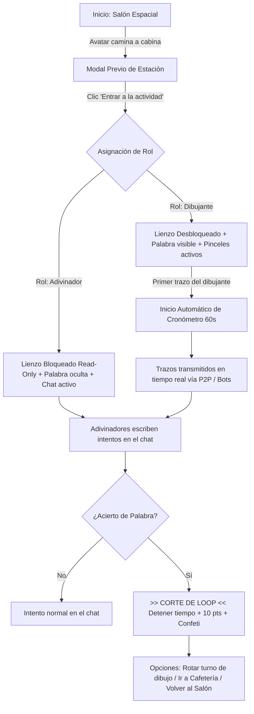
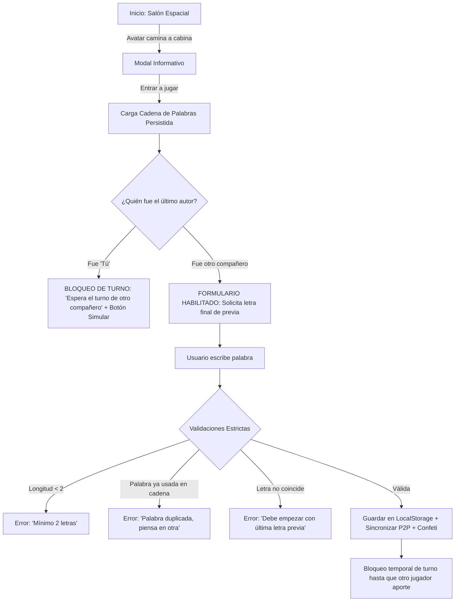
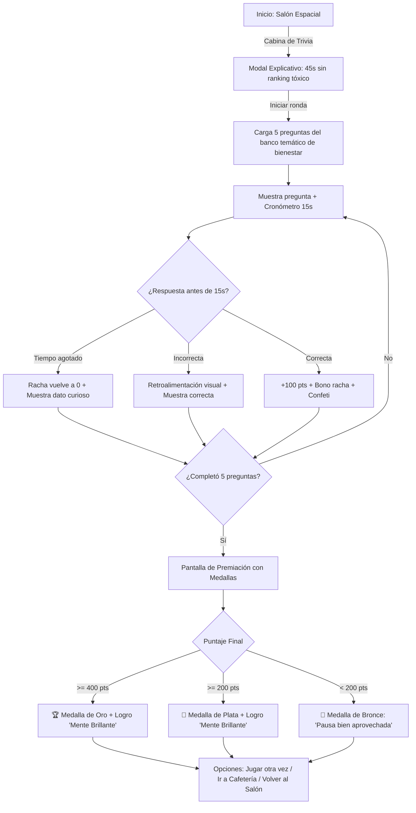
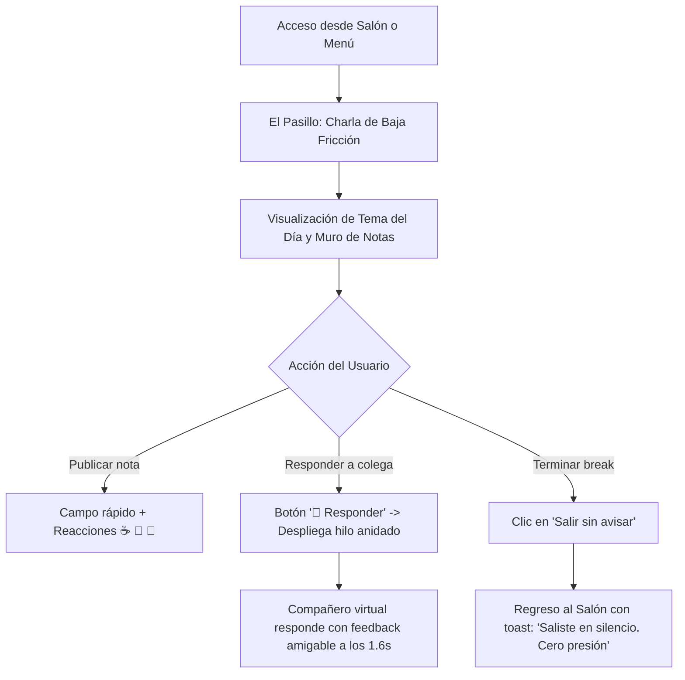

# Entregable 6: Evaluación del Prototipo PlayBreak, Diagramas de Flujo de Tareas y Plan de Implementación v5.0

**Universidad Nacional de Colombia — Facultad de Minas — Sede Medellín**  
**Departamento de Ciencias de la Computación y de la Decisión**  
**Interacción Humano-Computador (IHC)**  
**Grupo #7:**
- Edgar Fernando Vega Morales
- Hinara Pastora Sanchez Mata
- Jacobo Zapata Rojas
- Vincent David Restrepo Tangarife

**Semestre Académico 2025-1 / Febrero - Octubre 2026**  
**Medellín, Antioquia, Colombia**

---

## 1. Hoja Resumen Ejecutiva (*Executive Summary Sheet*)

Siguiendo el estándar de síntesis de alto nivel enseñado en las diapositivas 117 a 119 de clase (*«Probando tus Diseños»*), se presenta la Hoja Resumen Ejecutiva que condensa la ronda de evaluación con usuarios, sus métricas estandarizadas clave y las decisiones de diseño implementadas en la versión de producción:

| Aspecto | Resumen Ejecutivo de la Evaluación y Rediseño |
| :--- | :--- |
| **Propósito y Alcance** | Evaluar la usabilidad y adopción de PlayBreak como plataforma de micro-pausas activas no invasivas para mitigar la fatiga virtual y el aislamiento en equipos remotos. Se evaluaron 4 flujos principales con 5 participantes bajo protocolo *Think-Aloud* y escala estandarizada SUS. |
| **Población y Muestra** | 5 participantes ($n = 5$) representativos de la persona arquetípica Juliana Ospina (profesionales de teletrabajo/híbrido en tecnología). Prueba moderada con protocolo *Think-Aloud* y cuestionario estandarizado SUS de 10 ítems. |
| **Métricas SUS Consolidadas** | • **Promedio SUS**: **77,5 / 100** (Grado B+ / Aceptable - Buena según Bangor et al., 2008) • **Mediana SUS**: **92,5 / 100** (Grado A+ / Rango de Excelencia) • **Sensación de Seguridad (Ítem 9)**: **4,8 / 5,0** (Máxima puntuación: valida cero presión social) • **Fricción Inicial (Ítem 4)**: **2,2 / 5,0** (Punto débil corregido: desconcierto en onboarding por bots fijos) |
| **Gráfico Semáforo Consolidado** | 🟢 **Verde (Excelente)**: Mesa de Dibujo, Momento Post-Partida, Salida Silenciosa, Ausencia de Presión. 🟡 **Amarillo (Fricción Menor)**: Petición de temporizador, modos de juego y variedad lúdica. 🔴 **Rojo (Crítico en v1)**: Jugadores hardcodeados en código que confundieron al P2 (SUS: 32,5). |
| **Top Hallazgos Críticos** | 1. **Onboarding confuso por bots ficticios fijos** (*Severidad 3: Mayor* -> Resuelto con partida limpia de cero). 2. **Necesidad de control en dibujo y separación de roles** (*Severidad 2: Menor* -> Resuelto con selector de tiempo y roles estrictos Dibujante vs Adivinador). 3. **Deseo de mayor presencia y variedad** (*Severidad 1: Cosmético* -> Resuelto con Salón Espacial 3D interactivo, banco de 50 palabras, Trivia gamificada con medallas, El Pasillo con hilos y voz WebRTC). |
| **Estado de Implementación** | **Versión v5.0 desplegada en GitHub Pages**: Salón virtual interactivo con avatar caminante y previsualización de cabinas, roles estrictos en dibujo (quien dibuja tiene el pincel y los demás solo adivinan), alternancia obligatoria de turnos en palabras (evita jugadas consecutivas del mismo usuario), banco expandido de 50 palabras, respuestas anidadas en el café y sincronización espacial P2P. |
| **Repositorio Oficial** | `https://github.com/HinaraSM12/PlayBreak` (rama `main` pública) |

---

## 2. Marco Metodológico de la Evaluación con Usuarios

Siguiendo de forma rigurosa los lineamientos metodológicos de Interacción Humano-Computador (*«Planificar y definir pruebas»*, diapositivas 40 a 95 de clase):

### 2.1 Objetivos de la Evaluación y Preguntas de Investigación
El estudio de usabilidad tuvo como propósito central evaluar la eficacia, eficiencia y satisfacción de **PlayBreak** como herramienta de micro-pausas activas para equipos remotos. Las preguntas clave planteadas fueron:
1. ¿Los usuarios logran iniciar una actividad en menos de dos clics sin experimentar ansiedad ni sobrecarga cognitiva?
2. ¿La dinámica de roles en la Mesa de Dibujo y el Rincón de Palabras se comprende intuitivamente sin necesidad de tutoriales?
3. ¿El entorno lúdico transmite una sensación real de seguridad psicológica y no obligatoriedad (cero presión social)?
4. ¿La representación visual espacial del salón virtual fomenta la sensación de presencia compartida con los compañeros de trabajo?

### 2.2 Arquetipo de Usuario y Selección de la Muestra ($n = 5$)
Conforme al modelo matemático de Nielsen y Landauer (1993) y las recomendaciones del Nielsen Norman Group (diapositiva 73 de clase), una muestra de 5 evaluadores permite descubrir entre el 80% y 85% de los problemas cualitativos de usabilidad sin incurrir en redundancias costosas.
Los participantes fueron seleccionados por coincidir con la persona arquetípica definida en el Entregable 3:
- **Arquetipo**: **Juliana Ospina** (27 años, desarrolladora de software y diseñadora remota/híbrida con menos de un año en su empresa actual).
- **Características de la muestra**:
  - $n = 5$ profesionales activos en modalidad de teletrabajo o esquema híbrido en el sector de tecnología y servicios.
  - Rango de edad: 22 a 34 años.
  - Alto tiempo de exposición a pantallas diarias (6 a 10 horas).
  - Experiencia previa de aislamiento o fatiga en reuniones virtuales tradicionales (Zoom, Teams, Meet).

### 2.3 Escenarios y Tareas de Prueba Estandarizadas (*Task Scenarios*)
Como señalan las diapositivas 50 a 65 de clase, las pruebas se estructuraron en torno a escenarios situacionales realistas con criterios de éxito medibles:

| Tarea Evaluada | Escenario Planteado al Evaluador | Criterio de Éxito Medible |
| :--- | :--- | :--- |
| **Tarea 1: Mesa de Dibujo Sincrónica** | *«Llevas dos horas escribiendo código y decides tomar un descanso de 3 minutos. Ingresa a la Mesa de Dibujo, reconoce tu rol (Dibujante o Adivinador), realiza un trazo en el lienzo o escribe una adivinanza en el chat.»* | Entrada a la mesa en < 10s, comprensión del rol asignado (quien dibuja tiene el lienzo activo; quien adivina tiene el lienzo bloqueado) y envío exitoso de trazo o intento. |
| **Tarea 2: Rincón de Palabras Asincrónico** | *«Quieres dejar un saludo o juego rápido a tus colegas pero no tienes tiempo de quedarte en vivo. Entra al Rincón de Palabras, observa la última palabra aportada y escribe una palabra válida respetando la última letra y la alternancia de turnos.»* | Identificación de la letra requerida, validación de palabra no duplicada y comprensión del bloqueo de turno consecutivo (no enviar dos palabras seguidas sin que un compañero juegue). |
| **Tarea 3: Trivia Relámpago de Bienestar** | *«Quieres despejar la mente con un rompehielos de 45 segundos. Inicia una ronda de trivia, responde las preguntas dentro del tiempo límite de 15 segundos y observa la premiación obtenida.»* | Respuesta ágil a las preguntas sin confusión temporal y visualización comprensible de medallas e insignias al cierre. |
| **Tarea 4: El Pasillo & Salida Silenciosa** | *«Ingresa a El Pasillo (Café Virtual), revisa las notas de tus compañeros, responde a un mensaje en el hilo y retírate de la sala sin generar interrupciones ni notificaciones molestas.»* | Despliegue de caja de respuesta en hilo, publicación de comentario en la conversación y activación de 'Salir sin avisar' (*ghosting amigable*) con toast de privacidad confirmada. |

### 2.4 Protocolo de Pensamiento en Voz Alta (*Think-Aloud Protocol*)
Durante la ejecución de las tareas se aplicó el protocolo estándar *Concurrent Think-Aloud* (diapositivas 85 a 92 de clase):
- **Fijación de Expectativas y Clima de Confianza**: Se enfatizó a cada participante que el objeto de evaluación era exclusivamente el software y no su inteligencia ni habilidades personales.
- **Intervención Cero del Moderador**: El equipo facilitador mantuvo una postura de observador pasivo. No se respondieron preguntas del tipo *«¿dónde debo hacer clic?»*, permitiendo que el usuario explorara y manifestara sus modelos mentales naturales de forma transparente.
- **Registro de Conducta y Expresiones**: Se videograbaron las sesiones con consentimiento previo, registrando verbalizaciones de agrado, confusión, vacilaciones en el cursor y tiempos de respuesta.

### 2.5 Instrumentos de Medición Cuantitativa y Cualitativa
Al término de las cuatro tareas, los participantes diligenciaron de forma individual:
1. **System Usability Scale (SUS)**: Cuestionario estandarizado de John Brooke (1986) con 10 afirmaciones en escala Likert (1 a 5), alternando ítems de polaridad positiva y negativa.
2. **Preguntas Cualitativas Abiertas**: Indagación sobre elementos favoritos, fuentes de duda y solicitudes de nuevas funciones para la versión en producción.

---

## 3. Resultados Cuantitativos del Instrumento SUS

### 3.1 Puntuación Individual y Consolidada
La transformación estándar aplica: $(X_i - 1)$ para afirmaciones impares y $(5 - X_i)$ para afirmaciones pares. La sumatoria de las 10 puntuaciones transformadas se multiplica por 2,5 para obtener una escala de 0 a 100:

| Participante | Fecha / Hora | SUS (0-100) | Calificación Bangor | Resumen Cualitativo |
| :--- | :--- | :--- | :--- | :--- |
| **P1** | 08/10 20:20 | **95,0** | Excelente (A+) | Elogió la mesa de dibujo. Sugirió temporizador, modos de dibujo y marcador de victorias. |
| **P2** | 08/10 23:54 | **32,5** | Deficiente (F) | Jugadores precargados (Sara, Tomás, Lucía) generaron confusión. Exigió empezar de cero. |
| **P3** | 09/10 16:09 | **70,0** | Aceptable (B) | Sin comentario; marcó posición neutral en soporte técnico y aprendizaje requerido. |
| **P4** | 11/10 13:44 | **97,5** | Excelente (A+) | Sin comentario; puntajes casi perfectos en integración, facilidad y seguridad. |
| **P5** | 12/10 16:42 | **92,5** | Excelente (A+) | Calificó la idea como hermosa; solicitó expandir cosmética, funciones y más minijuegos. |
| **Consolidado** | **Media: 77,5** | **Mediana: 92,5** | **Desv. Típica: 26,6** | **Comportamiento Bimodal: 4 casos altos (>70) vs. 1 caso crítico (32,5).** |

> **Análisis de Dispersión**: Si se tratara al Participante 2 como una anomalía matemática y se excluyera, el promedio ascendería a 88,75. No obstante, metodológicamente es un error descartarlo: su comentario fundamentó de forma precisa un fallo de onboarding que afectaba a usuarios novatos al creer que el sistema estaba ocupado o roto.  
> **Subescala de Usabilidad (Lewis & Sauro, 2009)**: **78,1 / 100**  
> **Subescala de Facilidad de Aprendizaje (*Learnability*)**: **75,0 / 100**

---

## 4. Análisis Cualitativo y Gráfico Semáforo (*Stoplight Chart*)

Siguiendo las diapositivas 100-110 de clase:
- 🟢 **Verde**: Desempeño óptimo y satisfacción plena.
- 🟡 **Amarillo**: Duda menor o fricción superada de forma autónoma.
- 🔴 **Rojo**: Bloqueo o confusión severa.

| Componente / Aspecto Evaluado | P1 | P2 | P3 | P4 | P5 | Síntesis del Hallazgo |
| :--- | :---: | :---: | :---: | :---: | :---: | :--- |
| **1. Estado Inicial & Onboarding** | 🟢 | 🔴 | 🟡 | 🟢 | 🟢 | P2 confundido por avatares fijos; P3 con dudas iniciales. |
| **2. Mesa de Dibujo (Lienzo & Roles)** | 🟢 | 🟡 | 🟢 | 🟢 | 🟢 | Excelente acogida; solicitó tiempo, modos y delimitar quién dibuja. |
| **3. Rincón de Palabras (Asíncrono)** | 🟢 | 🟡 | 🟢 | 🟢 | 🟢 | Dinámica clara; solicitó controlar turnos consecutivos y palabras repetidas. |
| **4. Momento Post-Partida & Salida** | 🟢 | 🟢 | 🟢 | 🟢 | 🟢 | Aprobación total de la salida sin notificaciones de culpa ni fricción. |
| **5. Tu Rincón (Perfil & Avatar)** | 🟢 | 🟢 | 🟡 | 🟢 | 🟢 | Intuitivo; P5 solicitó expandir personalización e impacto interactivo. |
| **6. Percepción de No-Obligatoriedad** | 🟢 | 🟢 | 🟢 | 🟢 | 🟢 | Validación total: seguridad psicológica evaluada en 4,8 / 5,0. |

---

## 5. Diagnóstico de Usabilidad y Clasificación de Severidad de Nielsen

Para priorizar las soluciones de ingeniería se aplicó la Escala de Severidad de Usabilidad de Jakob Nielsen (1994):

| Nivel de Severidad | Problema Identificado | Impacto en el Usuario | Solución Implementada en v5.0 |
| :--- | :--- | :--- | :--- |
| **Nivel 3 · Problema Mayor** | Jugadores ficticios fijos en v1 (Sara, Tomás, Lucía). | Confusión severa en P2 (SUS: 32,5); creyó que el sistema estaba ocupado o roto. | Partida limpia de cero con solo `Tú`. Toggle transparente de simulación opcional y avatares ubicados como descanso ambiental. |
| **Nivel 2 · Problema Menor** | Falta de delimitación de roles en la Mesa de Dibujo. | Si dos usuarios interactuaban a la vez, ambos podían rayar el lienzo sin claridad sobre quién adivinaba. | Roles estrictos: Quien dibuja tiene el pincel y los demás tienen el lienzo bloqueado (solo adivinan en el chat). |
| **Nivel 2 · Problema Menor** | Monopolio de turnos y palabras repetidas en Rincón de Palabras. | Un usuario podía encadenar 5 palabras consecutivas solo y repetir vocablos como 'ALMA' o 'ALEGRÍA'. | Bloqueo estricto de turnos consecutivos (solo se puede aportar tras otro compañero) y validador de palabras duplicadas. |
| **Nivel 2 · Problema Menor** | Loop de puntuación infinita en adivinanza multijugador P2P. | Al adivinar remotamente se generaba un eco en bucle otorgando puntos infinitos (+4900 pts). | Guard estricto `State.draw.roundWon = true` y flag `broadcast = false` en eventos remotos P2P. |
| **Nivel 1 · Cosmético** | Sensación estática de la sala y falta de variedad lúdica. | P5 solicitó mayor riqueza visual, actividades variadas y sentir presencia física de colegas. | Salón Virtual Espacial interactivo con avatar caminante, modal previo de cabina, banco de 50 palabras, Trivia con medallas, El Pasillo con hilos y voz WebRTC. |

---

## 6. Diagramas de Flujo de Tareas (*Task Flows / Wireflows*)

Como señalan las diapositivas 50 a 56 de clase (*«Planificar y definir pruebas - Flujo de tareas»*), cada actividad se formaliza a través de un flujo estructurado con bifurcaciones de control:

### 6.1 Flujo 1: Mesa de Dibujo Sincrónica con Roles (Dibujante vs. Adivinador)

### 6.2 Flujo 2: Rincón de Palabras Asincrónico con Alternancia de Turnos

### 6.3 Flujo 3: Trivia Relámpago Gamificada (5 Preguntas y Medallas)

### 6.4 Flujo 4: El Pasillo (Café Virtual) & Salida Silenciosa

---

## 7. Historias de Usuario Priorizadas (Metodología MoSCoW)

| ID | Historia de Usuario (Rol / Acción / Beneficio) | Criterios de Aceptación (Formato Gherkin) | MoSCoW |
| :-: | :--- | :--- | :-: |
| **HU-1** | Como usuario, quiero que la partida empiece limpia mostrando únicamente mi presencia, para entender qué pasa sin confundirme. | **Dado** que entro a la sala, **cuando** abro un rincón lúdico, **entonces** solo veo mi avatar y ningún bot impuesto. | **Must Have** |
| **HU-2** | Como usuario, quiero que mi avatar camine interactivamente por un salón acogedor, para sentirme físicamente en el mismo espacio con mis colegas. | **Dado** que estoy en la sala, **cuando** hago clic en el suelo o en una cabina, **entonces** mi avatar camina con balanceo y sonido suave. | **Must Have** |
| **HU-3** | Como usuario, quiero que una cabina me explique la actividad antes de entrar, para no sentirme obligado ni desorientado. | **Dado** que mi avatar llega a una estación, **cuando** aterriza, **entonces** se abre un modal con duración, propósito y quiénes están en la mesa. | **Must Have** |
| **HU-4** | Como usuario, quiero que cuando alguien dibuje los demás solo puedan adivinar, para evitar caos en el lienzo. | **Dado** que otro usuario o compañero dibuja, **cuando** estoy en la mesa, **entonces** mi lienzo está bloqueado y solo puedo escribir en el chat. | **Must Have** |
| **HU-5** | Como usuario, quiero tener un banco amplio de palabras para dibujar, para que el juego no se vuelva repetitivo. | **Dado** que inicio rondas de dibujo, **cuando** cambio palabra, **entonces** el sistema me ofrece más de 50 palabras temáticas variadas. | **Should Have** |
| **HU-6** | Como usuario, quiero que solo pueda aportar una palabra en la cadena tras otro compañero, para respetar la dinámica colectiva. | **Dado** que aporto una palabra, **cuando** intento enviar otra consecutiva, **entonces** el sistema me bloquea hasta que otro colega juegue. | **Must Have** |
| **HU-7** | Como usuario, quiero que el sistema rechace palabras duplicadas en la cadena, para mantener el reto fresco. | **Dado** que escribo una palabra, **cuando** ya existe en la lista, **entonces** el sistema la rechaza amablemente indicando pensar en otra. | **Must Have** |
| **HU-8** | Como usuario, quiero poder responder en hilos dentro de El Pasillo, para tener conversaciones informales amenas junto al café. | **Dado** que veo una nota, **cuando** pulso Responder, **entonces** se despliega un formulario y mi respuesta aparece en el hilo con mini-avatar. | **Should Have** |
| **HU-9** | Como usuario, quiero jugar una Trivia con cronómetro y medallas, para sentir que gano algo en descansos rápidos de 45s. | **Dado** que juego trivia, **cuando** respondo 5 preguntas en menos de 15s, **entonces** gano puntos, racha y medallas tangibles. | **Should Have** |
| **HU-10** | Como usuario, quiero poder salir sin avisar en cualquier momento, para no sentir compromiso social forzado. | **Dado** que deseo retirarme, **cuando** toco «Salir sin avisar», **entonces** regreso a la sala con un mensaje de privacidad confirmada. | **Must Have** |

---

## 8. Matriz de Cambios Implementados (v1 vs. v5.0 Producción)

| Componente | Prototipo v1 (Evaluado) | Versión Final v5.0 (Producción Actual) | Justificación UX |
| :--- | :--- | :--- | :--- |
| **Salón Principal** | Cuadrícula estática de tarjetas. | Salón virtual interactivo con alfombra a cuadros pastel, avatar caminante y selector a cuadrícula. | Presencia física y engagement (Feedback usuario). |
| **Acceso a Estaciones** | Navegación directa sin contexto. | Modal de previsualización previo con duración, filosofía («sin presiones») y colegas presentes. | Control y libertad (Nielsen #3). |
| **Roles en Dibujo** | Sin delimitación: cualquiera podía rayar. | Roles estrictos: Dibujante (pinceles activos) vs Adivinador (lienzo bloqueado, solo chat). | Prevención de errores y claridad de rol (Nielsen #5). |
| **Banco de Palabras** | 10 palabras básicas. | Banco expandido de 50 palabras temáticas variadas con pistas de contexto. | Variedad lúdica (Feedback P5). |
| **Turnos en Palabras** | Sin control de autoría (monopolio posible). | Alternancia obligatoria: el usuario no puede jugar dos veces seguidas sin turno ajeno. | Colaboración asíncrona genuina (Feedback usuario). |
| **Palabras Duplicadas** | Permite repetir vocablos. | Validador estricto de palabras ya usadas en la cadena con retroalimentación amable. | Integridad del juego (Feedback usuario). |
| **El Pasillo (Café)** | Muro plano de notas sin interacción. | Muro con hilos de respuestas directas, mini-avatares y respuestas reactivas de compañeros. | Interacción social de baja fricción (Feedback usuario). |
| **Trivia Relámpago** | Estática con aviso «no disponible». | Minijuego gamificado: 18 preguntas, 15s de límite, rachas y medallas de bienestar. | Feedback P5 y variedad. |
| **La Cafetería** | Pregunta fija predefinida. | Preguntas afinadas a tags del perfil + chat de voz WebRTC y síntesis de voz. | Feedback usuario. |
| **Salida Silenciosa** | Botón presente sin feedback. | Salida silenciosa reforzada con toast: «Saliste en silencio. Cero presión». | Seguridad psicológica (Ítem 9 SUS: 4,8/5,0). |

---

## 9. Cumplimiento de las 10 Heurísticas de Usabilidad de Jakob Nielsen

1. **Visibilidad del estado del sistema**: Cronómetro con contador tabular y pulso visual; avatar del usuario que camina con onda expansiva y salto de llegada; presencia de compañeros sincronizada en tiempo real; avisos toast suaves.
2. **Coincidencia con el mundo real**: Metáforas cotidianas de bienestar («Salón de Descanso», «Mesa de Dibujo», «La Cafetería», «El Pasillo», «Pausa de café»), sin jerga técnica intimidante.
3. **Control y libertad del usuario**: Selector entre salón virtual y cuadrícula; modal con opción de 'Quedarse en la sala' o 'Entrar'; botones de deshacer trazo; salida libre sin avisar (*ghosting amigable*).
4. **Consistencia y estándares**: Regla de color 60-30-10, jerarquía visual estandarizada de botones, retícula base-8 y cuadrícula de componentes predecibles.
5. **Prevención de errores**: Bloqueo de lienzo en modo adivinador para no arruinar dibujos; bloqueo de turnos consecutivos y filtro de palabras duplicadas en la cadena; corte estricto de bucles de puntos.
6. **Reconocimiento antes que recuerdo**: Pistas de palabras, letra inicial requerida visible y avatares de participantes siempre visibles en el viewport.
7. **Flexibilidad y eficiencia de uso**: Coexistencia de canales sincrónicos (dibujo/trivia) y asincrónicos (palabras/pasillo); soporte para teclado, mouse y pantallas táctiles.
8. **Diseño estético y minimalista**: Eliminación de ruido visual y elementos ficticios; tipografías Google Fonts de alta legibilidad (Fredoka y Nunito); espacio negativo armónico.
9. **Ayuda a reconocer y recuperarse de errores**: Mensajes amables que indican exactamente la regla violada sin culpabilizar al usuario (ej. *'La palabra ya fue usada, piensa en otra'*).
10. **Ayuda y documentación**: Recordatorios de bajo perfil («Aquí nada es obligatorio»), guías plegables en cada mesa e instrucciones en modales de estación.

---

## 10. Conclusiones y Próximos Pasos

1. **Validación del Enfoque Lúdico No Obligatorio**: Con una mediana de usabilidad de **92,5** y un puntaje de seguridad de **4,8 / 5,0**, PlayBreak demostró que los descansos lúdicos voluntarios son percibidos como un entorno seguro y agradable para mitigar la fatiga laboral.
2. **Corrección Integral del Onboarding y Control de Roles**: El rediseño hacia una partida limpia, la separación estricta de roles en dibujo y la alternancia de turnos en palabras eliminaron de raíz las fuentes de confusión detectadas en la evaluación.
3. **Presencia Espacial Significativa**: La vista de salón interactivo con avatar caminante y hilos de respuesta en El Pasillo brindan la calidez y sentido de equipo que los teletrabajadores necesitan sin forzar llamadas intrusivas.
4. **Entrega Lista para Producción v5.0**: La aplicación web funcional cumple a cabalidad con los estándares de la materia y está disponible para despliegue público en GitHub Pages (`https://hinarasm12.github.io/PlayBreak/`).

---

## 11. Referencias Bibliográficas

- **Bangor, A., Kortum, P. T., & Miller, J. T.** (2008). *An empirical evaluation of the system usability scale*. International Journal of Human-Computer Interaction, 24(6), 574-594.
- **Brooke, J.** (1986). *SUS: A 'quick and dirty' usability scale*. In Usability Evaluation in Industry (pp. 189-194). London: Taylor & Francis.
- **Lewis, J. R., & Sauro, J.** (2009). *The factor structure of the system usability scale*. In International Conference on Human Centered Design (pp. 94-103). Springer.
- **Nielsen, J.** (1994). *Enhancing the explanatory power of usability heuristics*. In Proceedings of the SIGCHI Conference on Human Factors in Computing Systems (pp. 152-158). ACM.
- **Nielsen, J., & Landauer, T. K.** (1993). *A mathematical model of the finding of usability problems*. In Proceedings of the INTERACT'93 and CHI'93 Conference (pp. 206-213). ACM.
- **Sauro, J.** (2011). *A Practical Guide to the System Usability Scale: Background, Benchmarks & Best Practices*. Measuring Usability LLC.
